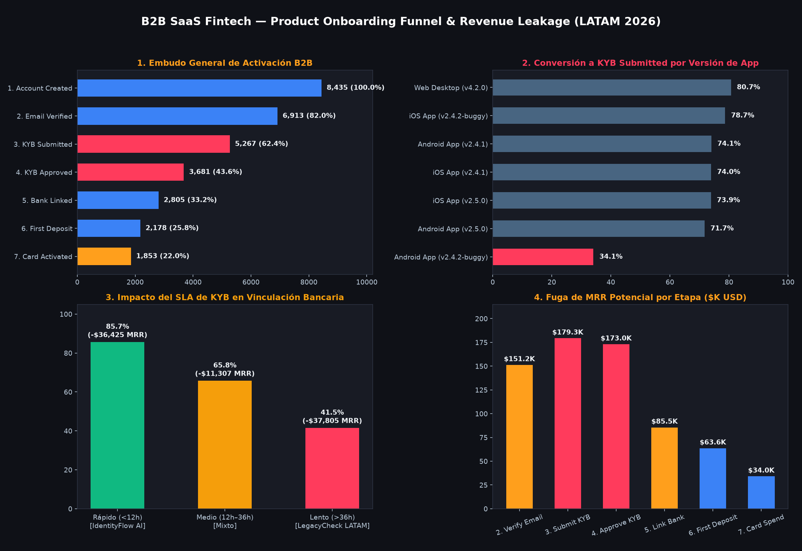

# ⚡ Product Onboarding & Payment Funnel Analysis | B2B SaaS Fintech (LATAM)


---

## 📌 Executive Summary (Resumen Ejecutivo)

Este proyecto analiza el embudo de adquisición, verificación regulatoria (**KYB - Know Your Business**) y activación financiera de **8,435 empresas B2B** en América Latina (MX, BR, CO, AR, CL, PE) registradas entre enero y septiembre de 2026 en una plataforma SaaS Fintech de tarjetas corporativas y gestión de tesorería[cite: 1, 2].

* **Diagnóstico Principal:** Solo el **21.97%** de las cuentas registradas (**1,853 empresas**) alcanza la métrica estrella de activación (`first_card_transaction`), reteniendo **$198,235 USD en MRR** de un potencial total de **$884,905 USD/mes** (**$686,670 USD/mes en MRR no capturado**, equivalente a **$8.24M USD en ARR**)[cite: 1, 2].
* **Concentración de Fuga (Revenue Leakage):** El **63.8%** de toda la pérdida de ingresos mensuales (**$437,811 USD en MRR**) ocurre entre la carga de documentos societarios (`kyb_submitted`), la aprobación regulatoria (`kyb_approved`) y la vinculación bancaria (`bank_linked`)[cite: 1, 2].
* **Impacto de Negocio Cuantificado:** A través del cruce de telemetría de producto y auditoría KYB, se aislaron **4 cuellos de botella técnicos y operativos** cuya corrección permite recuperar un estimado conservador de **+$80,320 USD en MRR mensual (+$963.8K USD en ARR)** sin incrementar el presupuesto de adquisición (CAC)[cite: 1, 2].



---

## 🎯 Business Problem (Problema de Negocio)

El equipo de Growth y Producto detectó un estancamiento en el *Net New ARR* pese al crecimiento sostenido en el registro de leads B2B a través de canales pagos y orgánicos[cite: 1]. La dirección ejecutiva necesitaba responder cuatro preguntas críticas:

1. **¿En qué etapas exactas del onboarding estamos perdiendo mayor volumen de cuentas y MRR potencial?**[cite: 1, 2]
2. **¿Las caídas de conversión responden a fricciones de UX/Ingeniería (bugs por dispositivo/versión) o a demoras operativas en la validación legal (KYB)?**[cite: 1, 2]
3. **¿Cómo impacta el tiempo de espera (SLA de aprobación KYB) en la probabilidad de que una empresa vincule su cuenta bancaria?**[cite: 1, 2]
4. **¿Qué diferencia de conversión al primer fondeo existe entre los rieles de Open Banking instantáneo y las transferencias manuales (CLABE / PIX / CBU)?**[cite: 1]

---

## 🛠️ Data Architecture & Methodology (Arquitectura y Metodología)

El análisis se construyó sobre un esquema relacional en estrella compuesto por **4 tablas (>50,000 registros combinados)** que simulan un entorno real de producción[cite: 1]:

1. **`dim_accounts.csv` (8,500 filas crudas / 8,435 limpias):** Padrón de empresas B2B, país, tamaño de compañía, industria, canal de adquisición, plan comercial y MRR esperado (`expected_plan_mrr_usd`)[cite: 1].
2. **`fact_funnel_events.csv` (33,092 filas crudas / 32,718 limpias):** Telemetría secuencial de las 7 etapas del producto, tipo de dispositivo, versión de la aplicación y estado del webhook[cite: 1].
3. **`fact_kyb_verifications.csv` (5,303 filas crudas / 5,267 limpias):** Registros de auditoría legal, proveedor validador (`IdentityFlow_AI` vs. `LegacyCheck_LATAM`), tiempos de resolución en horas (`review_duration_hours`) y motivos de rechazo[cite: 1].
4. **`fact_onboarding_transactions.csv` (4,057 filas crudas / 4,031 limpias):** Fondeo inicial de billetera (`WALLET_TOPUP_DEPOSIT`) y primer consumo con tarjeta corporativa (`CORPORATE_CARD_SPEND`)[cite: 1].

### Pipeline de Ingeniería y Calidad de Datos (Data Hygiene)
Antes de modelar el embudo, se implementó un pipeline determinístico de limpieza y validación (`src/01` y `src/02`):
* **Aislamiento de Tráfico Interno (QA Filtering):** Identificación y purga en cascada de **65 cuentas de prueba** (`@fintech-internal-qa.io`) y sus **229 eventos asociados** para evitar sesgos artificiales en las tasas de conversión[cite: 1].
* **Idempotencia de Telemetría (Deduplicación de Eventos):** Los SDKs móviles y webhooks dispararon **145 eventos duplicados** (`metadata_status = 'success_retry_duplicate'`) con 2 segundos de diferencia por micro-cortes de red en la etapa `account_created`[cite: 1]. Se aplicó deduplicación particionada por `(account_id, event_name)` conservando estrictamente el `MIN(event_timestamp)` para prevenir la inflación de MRR por *Fan-Out Trap* en los `JOINs`[cite: 1].
* **Normalización Taxonómica:** Estandarización de **16 variantes sucias de códigos de país** (`'mx'`, `'Mexico'`, `'ar'`, `'Argentina'`) al estándar ISO-2 y agrupación de **307 registros con atribución rota** (`(not set)`, `unknown`, `NULL`) bajo la categoría auditable `Unattributed / Direct`[cite: 1].

---

## 💻 Tech Stack & Granular Skills (Habilidades Técnicas)

* **Python (`Pandas`, `NumPy`, `Pathlib`):** Limpieza programática, pivoteo matricial a nivel cuenta, agregaciones condicionales con funciones `lambda`, cálculo de distribuciones de tiempo (*Time-to-Convert*) y pruebas de calidad con `assert`[cite: 1, 2].
* **SQL Avanzado (`PostgreSQL`):** Uso de *Common Table Expressions* (**CTEs**), funciones de ventana (`ROW_NUMBER() OVER (PARTITION BY ... ORDER BY ...)`), estandarización con `CASE WHEN` e integridad referencial[cite: 1].
* **Data Visualization & BI (`Matplotlib`, `Seaborn`, `Streamlit`):** Diseño de dashboards ejecutivos en modo oscuro de alto contraste y despliegue de aplicación interactiva con filtros dinámicos de segmentación[cite: 2].
* **Product & Financial Analytics:** Modelado de *Strict Funnel Conversion*, *Step-to-Step Drop-off*, análisis de SLA operativo y cuantificación de *MRR Leakage*[cite: 1, 2].

---

## 📊 Key Results & Bottleneck Analysis (Hallazgos Clave)

### 1. Rendimiento General del Embudo y Fuga de MRR

| Paso | Etapa del Funnel (`event_name`) | Cuentas Activas | Conv. Acumulada | Conv. del Paso | Drop-off del Paso | Mediana Tiempo | MRR Retenido (USD) | MRR Perdido en el Paso |
| :---: | :--- | :---: | :---: | :---: | :---: | :---: | :---: | :---: |
| **1** | `account_created` | 8,435 | 100.00% | 100.00% | 0.00% | 0.00 h | $884,905 | $0 |
| **2** | `email_verified` | 6,913 | 81.96% | 81.96% | 18.04% | 0.30 h | $733,675 | **$151,230** |
| **3** | `kyb_submitted` | 5,267 | 62.44% | 76.19% | **23.81%** | 12.90 h | $554,389 | **$179,286** |
| **4** | `kyb_approved` | 3,681 | 43.64% | **69.89%** | **30.11%** | 3.55 h | $381,401 | **$172,988** |
| **5** | `bank_linked` | 2,805 | 33.25% | 76.20% | 23.80% | 11.70 h | $295,864 | **$85,537** |
| **6** | `first_deposit_completed` | 2,178 | 25.82% | 77.65% | 22.35% | 17.34 h | $232,278 | **$63,586** |
| **7** | `first_card_transaction` | **1,853** | **21.97%** | 85.08% | 14.92% | 20.91 h | **$198,235** | **$34,043** |

*(Datos auditados tras exclusión de QA y deduplicación de eventos[cite: 1, 2]).*

### 2. Los 4 Cuellos de Botella Identificados (Deep-Dive)

1. **Bug Crítico en Android App `v2.4.2-buggy` (`email_verified` $\rightarrow$ `kyb_submitted`):**
   * Mientras que `Web Desktop (v4.2.0)` convierte al **80.68%** y las versiones estables de Android/iOS convierten entre **71.7% y 78.7%**, la versión **`Android App v2.4.2-buggy` se desploma al 34.10%** (solo 119 de 349 empresas logran subir su documentación societaria), bloqueando **$24,614 USD en MRR mensual**[cite: 1, 2].
2. **Ineficiencia del Proveedor KYB `LegacyCheck_LATAM` (`kyb_submitted` $\rightarrow$ `kyb_approved`):**
   * El motor automatizado **`IdentityFlow_AI`** aprueba al **77.43%** de las empresas con una mediana de respuesta de **2.57 horas**[cite: 1]. En contraste, **`LegacyCheck_LATAM`** (utilizado fuertemente en BR, AR y CO) registra apenas un **55.43% de aprobación** y una mediana de demora de **44.10 horas**, dejando **$96,477 USD de MRR** en estado rechazado o estancado[cite: 1, 2].
3. **Degradación de Conversión por SLA Lento (`kyb_approved` $\rightarrow$ `bank_linked`):**
   * Cuando la revisión KYB se resuelve en **menos de 12 horas**, el **85.67%** de las empresas aprobadas vincula su cuenta bancaria[cite: 1, 2]. Cuando el SLA supera las **36 horas**, la conversión se hunde al **41.54%** (el cliente B2B se enfría), provocando una pérdida adicional de **$37,805 USD en MRR** de empresas que ya habían sido aprobadas legalmente[cite: 1, 2].
4. **Fricción en Vinculación Bancaria Manual vs. Open Banking (`bank_linked` $\rightarrow$ `first_deposit_completed`):**
   * Las cuentas que conectan su banco mediante **`OpenBanking_API_Instant`** completan su primer depósito en el **85.08%** de los casos, frente a solo el **64.00%** de quienes utilizan validación manual (`Manual_CLABE_CBU_PIX`), donde quedan abandonados **$36,810 USD en MRR**[cite: 1].

---

## 💡 Business Recommendations (Recomendaciones Accionables)

| Stakeholder Principal | Acción Recomendada | Métrica Objetivo (KPI) | Impacto Financiero Estimado |
| :--- | :--- | :--- | :--- |
| **Mobile Engineering & QA** | Deprecar mediante *forced update* la versión `Android v2.4.2-buggy` y corregir el fallo de carga de archivos PDF/cámara hacia `v2.5.0+`[cite: 1, 2]. | Elevar conversión Paso 2 $\rightarrow$ 3 en Android del **34.1% al ~73.0%**[cite: 1, 2]. | **+$14,700 USD/mes** en MRR recuperado en el embudo[cite: 1]. |
| **Risk, Compliance & Ops** | Migrar el flujo de validación fiscal en BR, AR y CO desde `LegacyCheck_LATAM` hacia `IdentityFlow_AI` con pre-validación OCR en tiempo real[cite: 1]. | Reducir mediana de SLA de **44.1h a <4h** y subir aprobación del **55.4% al 75%+**[cite: 1]. | **+$33,700 USD/mes** en MRR desbloqueado en etapa KYB[cite: 1]. |
| **Product & Lifecycle Growth** | Implementar notificaciones *push*/WhatsApp automatizadas e incentivos de activación para cuentas cuyo KYB demore >12 horas, permitiendo pre-vincular el banco en modo *sandbox* mientras se aprueba el KYB[cite: 1, 2]. | Subir conversión a `bank_linked` en el segmento lento del **41.5% al 65%+**[cite: 1, 2]. | **+$18,900 USD/mes** en MRR retenido post-KYB[cite: 1, 2]. |
| **Payments & Integrations** | Promover `OpenBanking_API_Instant` como opción predeterminada en la UI y agregar verificación instantánea por micro-transferencia automatizada (PIX/SPEI/DEBIN)[cite: 1]. | Elevar conversión de fondeo manual del **64.0% al 78.0%**[cite: 1]. | **+$12,900 USD/mes** en MRR activado[cite: 1]. |

---

## 🔮 Limitations & Next Steps (Limitaciones y Siguientes Pasos)

* **Limitaciones Actuales:** El dataset abarca el embudo de adquisición e inicio transaccional (primeros 9 meses de 2026), pero no incluye la recurrencia de gasto mensual posterior al primer consumo (`Month 1 to Month 6 Retention`) ni los costos unitarios por consulta de API de cada proveedor KYB[cite: 1].
* **Siguientes Pasos:**
  1. **Análisis de Cohortes de Retención y LTV/CAC:** Cruzar las 1,853 cuentas activadas con la facturación recurrente de los meses siguientes para medir el *Net Dollar Retention (NDR)* por canal de adquisición[cite: 1].
  2. **Diseño de Experimento A/B en Onboarding:** Testear un flujo de *Progressive Onboarding* (permitir explorar el dashboard y pre-cargar métodos de pago antes de exigir los documentos societarios de KYB)[cite: 1].
  3. **Sistema de Alertas de Telemetría:** Configurar monitoreo automatizado para detectar caídas abruptas de conversión por versión de app (`app_version`) en las primeras 24 horas posteriores a cada despliegue[cite: 1, 2].

---

## 📂 Estructura del Repositorio

```text
b2b-saas-fintech-funnel-analysis/
│
├── data/
│   ├── raw/                                  # 4 CSVs originales con ruido de producción (QA, duplicados, ISO)
│   └── clean/                                # CSVs procesados + tabla maestra pivoteada a nivel cuenta
│
├── src/
│   ├── 01_data_cleaning_and_audit.py         # Filtro de cuentas QA y normalización ISO/canales
│   ├── 02_telemetry_idempotency_and_dedup.py # Deduplicación de eventos (MIN timestamp) + tests assert
│   ├── 03_funnel_analysis_and_insights.py    # Cálculo de métricas del funnel, MRR leakage y gráfico PNG
│   └── 04_streamlit_executive_app.py         # Aplicación interactiva en Streamlit para stakeholders
│
├── sql/
│   └── funnel_cleaning_and_metrics.sql       # Pipeline equivalente en PostgreSQL (CTEs + Window Functions)
│
├── assets/
│   └── saas_fintech_funnel_executive_dashboard.png
│
├── requirements.txt
└── README.md


🚀 Cómo Ejecutar este Proyecto Localmente
Clonar el repositorio y crear el entorno virtual:

Bash
git clone [https://github.com/FedericoSiso/b2b-saas-fintech-funnel-analysis.git](https://github.com/FedericoSiso/b2b-saas-fintech-funnel-analysis.git)
cd b2b-saas-fintech-funnel-analysis
python -m venv venv
source venv/Scripts/activate  # En Windows (Git Bash)
pip install -r requirements.txt

Correr el pipeline de Ingeniería de Datos y Análisis:

Bash
python src/01_data_cleaning_and_audit.py
python src/02_telemetry_idempotency_and_dedup.py
python src/03_funnel_analysis_and_insights.py

Lanzar la aplicación ejecutiva interactiva en Streamlit:

Bash
streamlit run src/04_streamlit_executive_app.py
